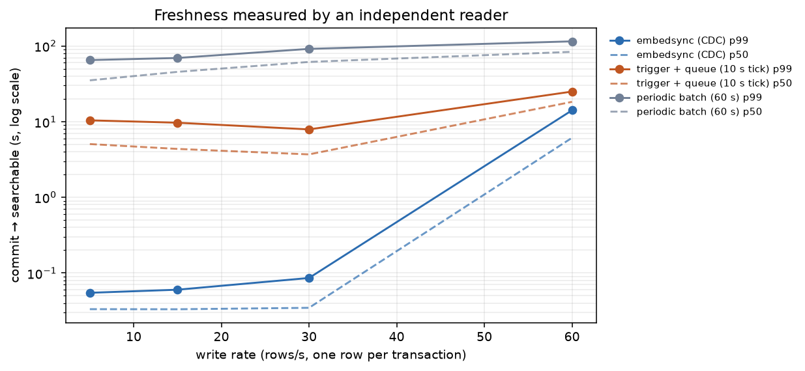
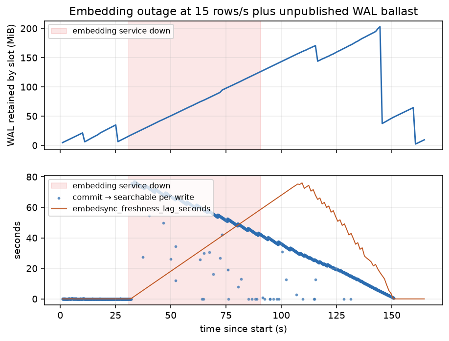

# postgres-embedding-sync

Keep pgvector search current as PostgreSQL rows change. `embedsync` reads a table
through logical replication, re-embeds only what changed, and writes chunks and
vectors to pgvector **in the same transaction as its replication checkpoint**, so a
crash can neither lose nor duplicate an effect. It measures how long a commit takes
to become searchable, and switches embedding models (blue/green, gated, reversible)
while serving searches.

* Go service (pgx, pglogrepl), a local CPU embedding service (sentence-transformers,
  pinned revisions, no API key), PostgreSQL 16/17/18 with pgvector.
* Status: **v0.2.0**, single table, single process. See [limitations](#limitations).

## Install

Download one installer from the [latest release](https://github.com/raunaksahahere/postgres-embedding-sync/releases/latest).
Everything is included, the embedding service as well. You don't need Python, Docker
or an API key.

| your system | file | install |
|---|---|---|
| Windows 10/11 (x64) | `embedsync-<version>-<variant>-windows-x64-setup.exe` | double-click; adds `embedsync` to your PATH (no admin rights needed) |
| macOS (Apple silicon) | `embedsync-<version>-<variant>-macos-arm64.dmg` | open it and run *Install embedsync.pkg* |
| Debian / Ubuntu (x64, arm64) | `embedsync-<version>-<variant>-linux-<amd64\|arm64>.deb` | `sudo apt install ./embedsync-…deb` |

Each comes in three variants. They differ only in which embedding models are included:

| variant | models included | download size (approx.) | pick it when |
|---|---|---|---|
| `minilm` | all-MiniLM-L6-v2 | ~290 MB | you want to start right away (recommended) |
| `nomodel` | none: setup downloads any Hugging Face model you name | ~210 MB | you know which model you want |
| `full` | all-MiniLM-L6-v2, bge-small-en-v1.5, paraphrase-MiniLM-L3-v2 | ~410 MB | offline machines, or comparing models with `migrate` |

Then, in a terminal:

```sh
embedsync setup          # guided: connects to your PostgreSQL, you pick the table, columns and
                         # model; it creates least-privilege roles and writes the config
embedsync run            # start syncing (leave it running)
embedsync search "how do I keep my indoor cat busy"     # in another terminal
```

You need PostgreSQL 16, 17 or 18 with [pgvector](https://github.com/pgvector/pgvector).
If PostgreSQL is missing, not running, has `wal_level` set wrong or lacks pgvector,
`embedsync setup` tells you exactly what to run on your OS and can fix `wal_level` itself.
`embedsync doctor` checks the whole installation at any time.

The installers are not code-signed. Windows SmartScreen may show *More info → Run anyway*.
On macOS, use *System Settings → Privacy & Security → Open Anyway* or
`sudo installer -pkg "/Volumes/embedsync/Install embedsync.pkg" -target /`.
Details, uninstalling and the CLI-only archives are covered in [docs/install.md](docs/install.md).

## Try the demo with Docker (no install)

Requirements: Docker with Compose v2.24+, ~3 GB RAM, ~2 GB disk.

```sh
git clone https://github.com/raunaksahahere/postgres-embedding-sync
cd postgres-embedding-sync
docker compose up -d --build
```

The first start downloads three pinned models (~290 MB) into the `hf-cache` volume;
later starts reuse it and can run offline (`HF_HUB_OFFLINE=1 docker compose up -d`).
The stack is PostgreSQL with a 48-row `public.documents` table, the embedder, and
`embedsync run`, which creates the slot and backfills the first generation
(all-MiniLM-L6-v2) in a few seconds.

```sh
alias es='docker compose exec embedsync embedsync'
alias sql='docker compose exec postgres psql -U postgres -d app -c'

es status                                            # checkpoint, slot, generations, freshness
es search "replication slot filling the disk with WAL"
#  1  0.6…  Replication slots and disk usage …

# Edit one row and delete another, then search again:
sql "UPDATE documents SET title = 'Keeping an indoor cat happy',
       body = 'Indoor cats need climbing shelves, daily play with a wand toy and a scratching post.' WHERE id = 2"
sql "DELETE FROM documents WHERE id = 1"

es search "how do I entertain my indoor cat"        # row 2 is now first
es search "replication slot filling the disk with WAL"   # row 1 is gone
es verify                                            # whole sink vs source at one boundary: ok
```

Both changes are searchable well under a second later (CI runs exactly this:
[`scripts/e2e.sh`](scripts/e2e.sh)). Prometheus and Grafana with a provisioned
dashboard and alert rules: `docker compose --profile observability up -d`, then
<http://127.0.0.1:53000>.

Change models without downtime:

```sh
es migrate --to bge          # build, catch up, run gates, promote atomically
es migrate status            # persisted gate reports
es migrate rollback          # back to the previous generation (rollback window: 30 min)
```

## Results

All numbers below were produced by `make bench` on one laptop
(AMD Ryzen 5 5600H with Radeon Graphics, 12 threads, 7.1 GB RAM, embedder limited to 4 torch threads; PostgreSQL 17.12 (Debian 17.12-1.pgdg12+1), pgvector 0.8.7, embedsync 0.1.0 at commit `aec93ac`) and are stored with seeds and commands in
[`bench/results/`](bench/results). Freshness workloads are **synthetic**; the retrieval
evaluation uses the real BEIR SciFact dataset.

### Freshness (commit → searchable)

An independent reader polls the serving chunk table through the read-only role and
records when each committed version becomes visible (one row per transaction; 60 %
updates, 25 % inserts, 15 % deletes; ~60–110-word documents; 2,000 preloaded rows;
all-MiniLM-L6-v2 on CPU).

| system | rate (rows/s) | achieved | writes | p50 | p99 | max | never visible | embeddings/s |
|---|---|---|---|---|---|---|---|---|
| embedsync | 5 | 5.02 | 300 | 33 ms | 55 ms | 67 ms | 0 | 4.23 |
| embedsync | 15 | 15.02 | 900 | 33 ms | 60 ms | 75 ms | 0 | 12.69 |
| embedsync | 30 | 30.02 | 1800 | 35 ms | 86 ms | 110 ms | 0 | 25.99 |
| embedsync | 60 | 60.01 | 3600 | 6.1 s | 14.1 s | 14.5 s | 0 | 41.42 |
| trigger + queue (10 s tick) | 5 | 5.02 | 300 | 5.1 s | 10.4 s | 11.0 s | 0 | — |
| trigger + queue (10 s tick) | 15 | 15.02 | 900 | 4.4 s | 9.7 s | 10.3 s | 0 | — |
| trigger + queue (10 s tick) | 30 | 30.02 | 1800 | 3.7 s | 7.9 s | 8.5 s | 0 | — |
| trigger + queue (10 s tick) | 60 | 60.01 | 3600 | 18.3 s | 25.0 s | 25.4 s | 0 | — |
| periodic batch (60 s) | 5 | 5.02 | 300 | 35.2 s | 65.2 s | 65.8 s | 0 | — |
| periodic batch (60 s) | 15 | 15.02 | 900 | 45.6 s | 69.5 s | 70.1 s | 0 | — |
| periodic batch (60 s) | 30 | 30.02 | 1800 | 61.6 s | 91.7 s | 92.3 s | 0 | — |
| periodic batch (60 s) | 60 | 60.01 | 3600 | 83.8 s | 115.2 s | 115.9 s | 0 | — |

Up to 30 rows/s every write was searchable within 110 ms. At 60 rows/s the CPU
embedder (4 torch threads, ~41 embeddings/s here) is the bottleneck: a backlog builds
and latency rises to seconds for embedsync and for the trigger + queue baseline, which
calls the same embedder, but no write was lost. Use a faster embedder to raise this limit.



**Outage.** At 15 rows/s plus ~2 MB/s of unpublished WAL from another
table, the embedding service was stopped for 60 s. The slot retained up
to 203 MiB of WAL; nothing was acknowledged during the outage; after the
service returned the backlog drained, retained WAL fell back to
10 MiB, and every write became visible (never visible:
0; p99 over the whole run 75.6 s).



### Consistency

The integration suite runs against real PostgreSQL 16, 17 and 18 (and once under the Go
race detector) and checks the **entire** sink against the source with
`embedsync verify` after each scenario: kill before sink commit and after commit
before feedback, SIGKILL loops under concurrent writers with aborted transactions,
duplicates after restart, chunk shrink, key changes, deletes, truncate, unchanged
TOAST, schema change, embedding outage, poison rows, slot loss, and backfill under
writes. A property test runs 1,000 random backfill/stream interleavings.

CI run [44867185233](https://github.com/raunaksahahere/postgres-embedding-sync/actions/runs/44867185233)
(commit `aec93ac`, Go 1.27.4, pgvector 0.8.7): all 15 integration tests passed on every server, and each
of the 30 full-sink `verify` checks per job reported **0 missing, 0 extra, 0 stale**.

| server | SIGKILLs under writers (commits / aborts) | failpoint crashes (2 × 4) | backfill under writes (windows / commits) | embedder outage (retries / quarantined) | reader during promote → rollback (searches / errors) | suite time |
|---|---|---|---|---|---|---|
| PostgreSQL 16.16 | 5 (7,731 / 1,957) | 8 | 66 / 1,129 | 94 / 0 | 184 / 0 | 140 s |
| PostgreSQL 17.12 | 5 (6,924 / 1,777) | 8 | 66 / 1,126 | 94 / 0 | 185 / 0 | 135 s |
| PostgreSQL 18.7 | 5 (10,847 / 2,748) | 8 | 66 / 1,116 | 95 / 0 | 157 / 0 | 153 s |
| PostgreSQL 17.12, `-race` | 5 (10,798 / 2,737) | 8 | 66 / 1,181 | 94 / 0 | 222 / 0 | 258 s |

Writer errors were 0 in every run, and the concurrent reader never returned a wrong top-1 result.

Details: [docs/guarantees.md](docs/guarantees.md).

### Model migration on SciFact

500 judged queries sampled with a fixed seed from BEIR SciFact (5,183 abstracts),
gates declared in [`bench/embedsync.bench.yaml`](bench/embedsync.bench.yaml) before
the run: candidate ANN-vs-exact recall@10 ≥ 0.95 and paired-bootstrap (2,000
resamples, 95 %) lower bounds of Δ nDCG@10 and Δ recall@10 ≥ −0.01, plus coverage,
zero unresolved rows and catch-up.

| | generation | model | nDCG@10 (ANN) | recall@10 (ANN) | nDCG@10 (exact) | ANN vs exact recall@10 |
|---|---|---|---|---|---|---|
| initial | `minilm` | sentence-transformers/all-MiniLM-L6-v2 | 0.6639 | 0.7956 | 0.6679 | 0.9946 |
| candidate 1 | `bge` | BAAI/bge-small-en-v1.5 | 0.7371 | 0.8499 | 0.7409 | 0.9938 |
| candidate 2 | `minilm_l3` | sentence-transformers/paraphrase-MiniLM-L3-v2 | 0.5422 | 0.6949 | 0.5421 | 0.9944 |

* **minilm → bge: PROMOTED.** Δ nDCG@10 = +0.0732 (95 % CI +0.0506 … +0.0958), Δ recall@10 = +0.0543 (+0.0287 … +0.0827); coverage 10,047 chunks, 0 missing/extra/stale.
* **bge → paraphrase-MiniLM-L3: REJECTED** (expected regression). Δ nDCG@10 = -0.1949 (-0.2249 … -0.1651); bge kept serving.
* **Rollback** bge → minilm: ok.
* **Reader during all three operations** (2,999 concurrent writes): 18,158 searches, **0 errors**, latency p50 27 ms / p99 79 ms; cutovers seen by the reader: minilm→bge gap 64 ms; bge→minilm gap 80 ms.

Methodology and full reports: [docs/evaluation.md](docs/evaluation.md).

## How it works

```
source table ──pgoutput──▶ reader ─▶ planner ─▶ embed ─▶ committer ──▶ chunks_<generation> (pgvector)
      ▲                      │ feedback = durable LSN only        └─ same transaction: effects,
      └── low/high markers ◀─ backfill (bounded PK scans)              DLQ, progress, checkpoint
```

* **CDC**: explicit publication with a column list (key + allowlisted columns) plus
  the backfill marker table; whole transactions; idempotent effects and the end LSN in
  one sink transaction; standby feedback only up to durable progress, also on
  keepalives; source/slot identity checks on restart.
* **Chunks**: deterministic chunk IDs, fingerprints over text + transform + model
  revision, unchanged chunks skipped, obsolete chunks removed, unchanged TOAST resolved
  or paused, schema changes pause before acknowledging; bounded queues, rate limiting,
  jittered retries, graceful shutdown; poison rows quarantined atomically in a
  persistent, versioned DLQ (`embedsync dlq list|inspect|replay`) or pause.
* **Backfill**: watermark windows with committed low/high markers consumed in the
  stream; deletes, key changes and truncate reconciled; resumable progress stored with
  the effects.
* **Generations**: per-model chunk tables and metadata; queries pinned to the
  generation's encoder (even for equal-dimension models); promotion only after
  coverage, catch-up and quality gates; rollback window; resumable migrations.

More: [docs/architecture.md](docs/architecture.md).

## Commands

| command | |
|---|---|
| `embedsync setup [--yes --admin-url U --table T --columns a,b --model M]` | guided first-run setup (installed packages) |
| `embedsync doctor [--skip-embedder]` | check installation, config, database and embedder |
| `embedsync model list \| add <owner/name[@rev]>` | list models, add one from Hugging Face |
| `embedsync init` | create control objects, publication and sink schema (admin DSNs) |
| `embedsync run [--accept-schema-change]` | stream, backfill, serve `/metrics` `/status` `/search` `/readyz` |
| `embedsync backfill [--generation G] [--wait]` | queue a watermark re-scan |
| `embedsync status [--json]` | checkpoint, slot and retained WAL, generations, DLQ, migrations |
| `embedsync migrate --to <model> [--gate-only] [--restart]` | build, gate and promote a generation |
| `embedsync migrate status \| rollback \| finalize [--force]` | inspect gates, roll back, retire |
| `embedsync search [--k N] [--generation G] [--exact] <query>` | pinned search |
| `embedsync verify [--timeout D]` | full sink-vs-source comparison (exit 4 on differences) |
| `embedsync dlq list \| inspect --id N \| replay [--id N]` | quarantined rows |
| `embedsync rebuild --confirm` | recover from slot loss into a fresh generation |

Configuration: [`examples/embedsync.yaml`](examples/embedsync.yaml) (every option
commented). Credentials come only from environment variables named in the config;
`embedsync setup` writes them to an `embedsync.env` file next to the config, readable
only by you, and the real environment always takes precedence. With
`embedder.managed: true` (what setup writes), embedsync starts the bundled embedder on
a private localhost port and stops it on exit.

## Operations

[docs/operations.md](docs/operations.md): roles and least privilege, retained WAL and
alerts, pauses, DLQ, slot loss and rebuild, upgrades, model cache and offline use.

## Comparison

| | embedsync | [CocoIndex Postgres source][coco] | [Pathway][pw] | [Supabase automatic embeddings][supa] |
|---|---|---|---|---|
| change detection | logical replication (pgoutput) | one-shot scan per `cocoindex update` run ("re-run it after the source table changes") | PostgreSQL WAL input connector ("consuming diffs from the PostgreSQL Write-Ahead Log") or Debezium | triggers enqueue to pgmq; pg_cron job every 10 s |
| deletes | streamed; reconciled in backfill | removed from the target when the row disappears (on the next run) | streamed | not covered by the guide |
| skip unchanged work | per-chunk fingerprint incl. model revision | memoization on content and code | — | re-embeds on `UPDATE OF` listed columns |
| exactly-once effects with position | yes (same sink transaction) | idempotent upserts | connector persistence; temporary slot otherwise | queue + visibility timeout (retries) |
| model switch | gated blue/green with rollback | re-embeds when the model changes (`detect_change=True`) | — | not covered by the guide |
| measured freshness | yes (this README) | — | — | "wait up to 10 seconds" |

Sources: [CocoIndex example][coco] and [connector docs][coco2]; [Pathway Postgres
connector][pw] (licensed tiers) and [document indexing][pw2]; [Supabase guide][supa].
"—" means the cited page does not say. CocoIndex and Pathway are general frameworks with
far broader scope (many sources/targets, transformations); embedsync does one thing:
one Postgres table into pgvector with transactional guarantees.

[coco]: https://cocoindex.io/docs/examples/postgres-source/
[coco2]: https://cocoindex.io/docs/connectors/postgres/
[pw]: https://pathway.com/developers/api-docs/pathway-io/postgres
[pw2]: https://pathway.com/developers/user-guide/llm-xpack/docs-indexing
[supa]: https://supabase.com/docs/guides/ai/automatic-embeddings

## Limitations

* One source table per process, single-column primary key (int, text or uuid); no
  joins, no hybrid (lexical) search, no external vector stores (v1 scope).
* Throughput is bounded by the CPU embedding model (~70 short documents/s for
  all-MiniLM-L6-v2 on the benchmark laptop); sustained writes above that grow the
  backlog (freshness alerts fire, WAL is retained up to `max_slot_wal_keep_size`).
* A pause (schema change, `on_poison: pause`, unresolvable TOAST) stops freshness for
  the table until an operator acts.
* Search is eventually consistent with the source (see the measured latency).
* The benchmark is one laptop and synthetic write workloads; your numbers will differ.
* Installers: macOS builds are Apple silicon only (PyTorch no longer publishes Intel
  macOS wheels); Linux packages need glibc 2.28+. Intel Macs and other systems can use
  the CLI-only archives with the Docker embedder. The installers are not code-signed.

## Development

| suite | command |
|---|---|
| formatting | `make fmt-check` |
| static checks (vet, staticcheck, ruff) | `make lint` |
| Go race + unit + property tests, embedder and bench tests | `make test` |
| integration on real PostgreSQL (Docker) | `make integration PG=16\|17\|18`, `make integration-race` |
| quickstart end to end | `make e2e` |
| pinned images check | `make images-check` |
| benchmarks and evaluation | `make bench` (or `cd bench && uv run embedsync-bench freshness\|outage\|baselines\|retrieval`) |
| release archives + install check | `make release-check` |
| native installers (on each OS; CI: `.github/workflows/packages.yml`) | `packaging/build.sh <version> <goos> <goarch> <embedder_dist> <out>` |

## License

Apache-2.0. See [LICENSE](LICENSE) and [NOTICE](NOTICE) (models and the SciFact
dataset are downloaded at run time, not redistributed).
