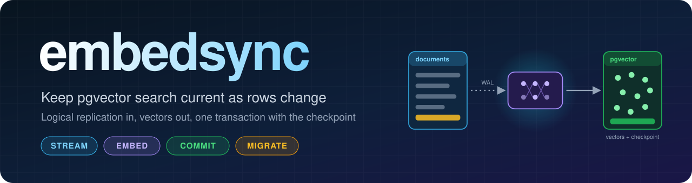
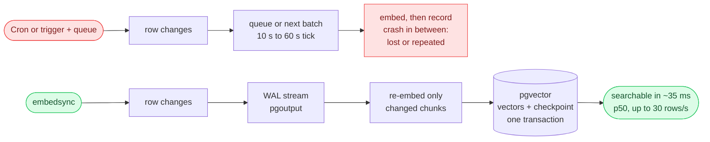
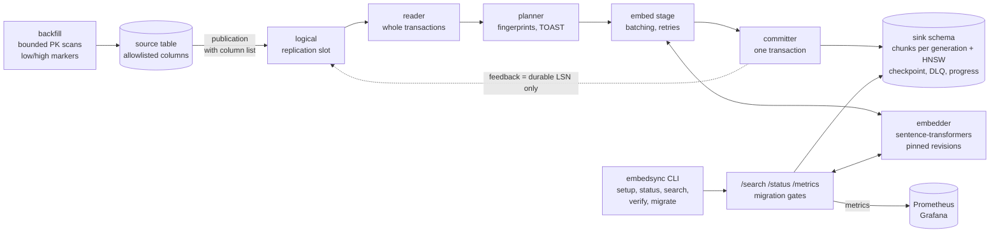

<p align="center">
  
</p>

<p align="center">
  <a href="https://github.com/raunaksahahere/postgres-embedding-sync/actions/workflows/ci.yml"></a>
  <a href="https://github.com/raunaksahahere/postgres-embedding-sync/releases/latest"></a>
  
  
  
  
  <a href="LICENSE"></a>
  
</p>

<p align="center">
  <a href="#install"><b>Install</b></a> ·
  <a href="#what-it-handles"><b>What it handles</b></a> ·
  <a href="#how-it-works"><b>How it works</b></a> ·
  <a href="#results"><b>Results</b></a> ·
  <a href="#limitations"><b>Limitations</b></a> ·
  <a href="#documentation"><b>Documentation</b></a>
</p>

---

**Keep pgvector search current as PostgreSQL rows change, without losing or duplicating a single update.**

Embeddings go stale the moment the row behind them changes. The usual fixes are a cron job that
re-embeds everything, or a trigger that fills a queue that a worker drains every few seconds:
both leave search wrong for seconds to minutes, and a crash between "embedded" and "recorded" can
lose or repeat work. **embedsync** reads the table through **logical replication**, re-embeds only
the chunks that changed, and writes the vectors to pgvector **in the same transaction as its
replication checkpoint**, so a crash can neither lose nor duplicate an effect. It measures how long
a commit takes to become searchable, and switches embedding models (blue/green, gated, reversible)
while serving searches.

* Go service (pgx, pglogrepl), a local CPU embedding service (sentence-transformers, pinned
  revisions, no API key), PostgreSQL 16, 17 or 18 with pgvector.
* Status: **v0.5.0**: embedding providers (OpenAI-compatible and Gemini endpoints, routed per
  generation), document views from related tables, several tables per process (pipelines),
  composite primary keys, single process. See [limitations](#limitations).



```console
$ embedsync search "replication slot filling the disk with WAL"
generation minilm (sentence-transformers/all-MiniLM-L6-v2@1110a243fd) embed 11.8ms query 2.1ms
 1. [1] 0.855  Replication slots and disk usage An inactive replication slot keeps WAL on disk until its consumer confirms it…
 2. [2] 0.031  Indoor cat care Cats need shelves to climb and a quiet place to sleep.
 3. [3] -0.010  Sourdough basics Feed the starter flour and water every day.

$ psql -c "UPDATE documents SET title = 'Keeping an indoor cat happy', body = 'Indoor cats need climbing shelves, ...' WHERE id = 2" \
       -c "DELETE FROM documents WHERE id = 1"

$ embedsync search "how do I entertain my indoor cat"
generation minilm (sentence-transformers/all-MiniLM-L6-v2@1110a243fd) embed 11.8ms query 2.1ms
 1. [2] 0.705  Keeping an indoor cat happy Indoor cats need climbing shelves, daily play with a wand toy and a scratching pos…
 2. [3] 0.100  Sourdough basics Feed the starter flour and water every day.

$ embedsync search "replication slot filling the disk with WAL"
generation minilm (sentence-transformers/all-MiniLM-L6-v2@1110a243fd) embed 11.6ms query 1.9ms
 1. [2] 0.056  Keeping an indoor cat happy Indoor cats need climbing shelves, daily play with a wand toy and a scratching pos…
 2. [3] -0.010  Sourdough basics Feed the starter flour and water every day.

$ embedsync verify
boundary 0/16BF970 checkpoint 0/16BF970 source rows 2
source_state: missing=0 extra=0 stale=0
minilm: chunks expected=2 actual=2 missing=0 extra=0 stale=0 quarantined_keys=0
ok=true
```

<sub>A real run of the installed v0.2.0 on a laptop: the three-row table was set up with `embedsync setup`, the bundled all-MiniLM-L6-v2 embedder started by `embedsync run`, PostgreSQL 17 with pgvector 0.8.7. The edit and delete were searchable within a second of the commit; the [benchmarks](#results) measure the latency properly.</sub>

## Three answers from `verify`, and nothing in between

`embedsync verify` compares **every row of the source** with **every chunk in the sink** at one replication boundary.

| Result | Exit | Meaning |
|---|:-:|---|
| ✅ **ok** | `0` | Zero missing, zero extra, zero stale chunks for every generation, at one consistent boundary. |
| ❌ **differences** | `4` | The sink differs from the source. The report counts them per generation. |
| ⚠️ **error** | `1` | The check could not run (for example the checkpoint never reached the barrier). It is never reported as ok. |

## What it handles

Each row is covered by a named integration test against real PostgreSQL 16, 17 and 18
([guarantees](docs/guarantees.md)).

| What goes wrong | What embedsync does | Lost or duplicated |
|---|---|:-:|
| `kill -9` before the sink commit, or after it but before feedback | the effects and the checkpoint LSN are one transaction; feedback reports only the durable LSN | 0 |
| Aborted transactions, concurrent writers | pgoutput only delivers committed transactions; whole transactions are applied | 0 |
| Backfill running while rows are inserted, updated, deleted and re-keyed | watermark windows consumed in the same stream; deletes are never resurrected | 0 |
| The embedding service is down | retries with jittered backoff, nothing is acknowledged, the backlog drains on return | 0 |
| A row the embedder rejects (poison) | quarantined atomically in a versioned dead-letter queue (or pause); replay with `embedsync dlq replay` | 0 |
| Schema change on the source table | the stream pauses before acknowledging; you accept it with `--accept-schema-change` | 0 |
| Replication slot lost | detected on restart; `embedsync rebuild --confirm` recovers into a fresh generation | 0 |
| Secret columns next to the text | only allowlisted columns are published, granted and selected | none leave the source |
| Switching to a worse model | candidate generation must pass coverage, catch-up and quality gates; rollback window | readers see 0 errors |
| One transaction writes to several synced tables | all tables share one slot; a source transaction is applied in one sink transaction, even when its embeddings finish out of order | readers never see half of it |
| A section is moved, a tag renamed, or several tables edited in one transaction (document views) | the document is assembled once from the state after the transaction and rewritten once; no live reads of the source | one final document, never a mix |

## Why embedsync

| | Feature | What it means |
|:-:|---|---|
| 🔁 | **Transactional checkpoint** | Vectors, the dead-letter queue and the replication position commit together. No window in which a crash loses or repeats work. |
| ⚡ | **Millisecond freshness** | A commit is searchable in a median of 33 to 35 ms up to 30 rows/s on a laptop CPU; trigger + queue and periodic batches take seconds to minutes ([results](#results)). |
| 🧩 | **Re-embeds only what changed** | Per-chunk fingerprints over text, transform and model revision skip unchanged chunks and remove obsolete ones. |
| 🔀 | **Blue/green model migration** | Build a new generation next to the live one, gate it, promote atomically, roll back within a window. Queries stay pinned to the encoder of the generation they hit. |
| 🛡️ | **Least privilege** | Separate replicator, sink and read-only roles; column-level grants; credentials only from environment variables. |
| 📦 | **Install and run** | Windows, macOS and Debian/Ubuntu installers with the embedding service inside; `embedsync setup` walks you through it. |
| 📈 | **Observable** | Prometheus metrics, a Grafana dashboard, alert rules, `embedsync status` and a runbook ([operations](docs/operations.md)). |
| 🔌 | **No API key** | A local CPU embedder with pinned model revisions; any sentence-transformers model works. |

## Install


Download one installer from the [latest release](https://github.com/raunaksahahere/postgres-embedding-sync/releases/latest).
Everything is included, the embedding service as well. You don't need Python, Docker
or an API key.

| your system | file | install |
|---|---|---|
| Windows 10/11 (x64) | `embedsync-<version>-<variant>-windows-x64-setup.exe` | double-click; adds `embedsync` to your PATH (no admin rights needed) |
| macOS (Apple silicon) | `embedsync-<version>-<variant>-macos-arm64.dmg` | open it and run *Install embedsync.pkg* |
| Debian / Ubuntu (x64, arm64) | `embedsync-<version>-<variant>-linux-<amd64\|arm64>.deb` | `sudo apt install ./embedsync-…deb` |

Each comes in three variants. They differ only in which embedding models are included:

| variant | models included | download size (approx.) | pick it when |
|---|---|---|---|
| `minilm` | all-MiniLM-L6-v2 | ~290 MB | you want to start right away (recommended) |
| `nomodel` | none: setup downloads any Hugging Face model you name | ~210 MB | you know which model you want |
| `full` | all-MiniLM-L6-v2, bge-small-en-v1.5, paraphrase-MiniLM-L3-v2 | ~410 MB | offline machines, or comparing models with `migrate` |

Then, in a terminal:

```sh
embedsync setup          # guided: connects to your PostgreSQL, you pick the table, columns and
                         # model; it creates least-privilege roles and writes the config
embedsync run            # start syncing (leave it running)
embedsync search "how do I keep my indoor cat busy"     # in another terminal
```

You need PostgreSQL 16, 17 or 18 with [pgvector](https://github.com/pgvector/pgvector).
If PostgreSQL is missing, not running, has `wal_level` set wrong or lacks pgvector,
`embedsync setup` tells you exactly what to run on your OS and can fix `wal_level` itself.
`embedsync doctor` checks the whole installation at any time.

The installers are not code-signed. Windows SmartScreen may show *More info → Run anyway*.
On macOS, use *System Settings → Privacy & Security → Open Anyway* or
`sudo installer -pkg "/Volumes/embedsync/Install embedsync.pkg" -target /`.
Details, uninstalling and the CLI-only archives are covered in [docs/install.md](docs/install.md).

## Try the demo with Docker (no install)


Requirements: Docker with Compose v2.24+, ~3 GB RAM, ~2 GB disk.

```sh
git clone https://github.com/raunaksahahere/postgres-embedding-sync
cd postgres-embedding-sync
docker compose up -d --build
```

The first start downloads three pinned models (~290 MB) into the `hf-cache` volume;
later starts reuse it and can run offline (`HF_HUB_OFFLINE=1 docker compose up -d`).
The stack is PostgreSQL with a 48-row `public.documents` table, the embedder, and
`embedsync run`, which creates the slot and backfills the first generation
(all-MiniLM-L6-v2) in a few seconds.

```sh
alias es='docker compose exec embedsync embedsync'
alias sql='docker compose exec postgres psql -U postgres -d app -c'

es status                                            # checkpoint, slot, generations, freshness
es search "replication slot filling the disk with WAL"
#  1  0.6…  Replication slots and disk usage …

# Edit one row and delete another, then search again:
sql "UPDATE documents SET title = 'Keeping an indoor cat happy',
       body = 'Indoor cats need climbing shelves, daily play with a wand toy and a scratching post.' WHERE id = 2"
sql "DELETE FROM documents WHERE id = 1"

es search "how do I entertain my indoor cat"        # row 2 is now first
es search "replication slot filling the disk with WAL"   # row 1 is gone
es verify                                            # whole sink vs source at one boundary: ok
```

Both changes are searchable well under a second later (CI runs exactly this:
[`scripts/e2e.sh`](scripts/e2e.sh)). Prometheus and Grafana with a provisioned
dashboard and alert rules: `docker compose --profile observability up -d`, then
<http://127.0.0.1:53000>.

Change models without downtime:

```sh
es migrate --to bge          # build, catch up, run gates, promote atomically
es migrate status            # persisted gate reports
es migrate rollback          # back to the previous generation (rollback window: 30 min)
```

## How it works



1. **Follow.** An explicit publication with a column list (the key plus allowlisted columns) and
   the backfill marker table feeds a logical slot. Whole transactions are read; source and slot
   identity are checked on restart.
2. **Plan.** Each change becomes chunks with deterministic IDs and fingerprints over text,
   transform and model revision. Unchanged chunks are skipped, obsolete ones removed, unchanged
   TOAST values resolved from stored state or deferred.
3. **Embed.** Bounded queues, rate limiting and jittered retries talk to the local embedder. Rows it
   rejects are quarantined in a persistent, versioned DLQ (`embedsync dlq list|inspect|replay`), or the
   pipeline pauses by policy.
4. **Commit.** Effects, DLQ records, progress and the end LSN go into **one sink transaction**.
   Standby feedback reports only that durable position, also on keepalives, so the slot never moves
   ahead of what is safely stored.
5. **Backfill.** Watermark windows with committed low/high markers are consumed in the same stream,
   so snapshot rows yield to concurrent changes. Deletes, key changes and truncate are reconciled and
   progress is resumable.
6. **Migrate.** Each model gets its own chunk tables; queries are pinned to the generation's encoder
   (even for equal-dimension models). Promotion happens only after coverage, catch-up and quality
   gates, with a rollback window and resumable migrations.

More: [docs/architecture.md](docs/architecture.md) and [docs/guarantees.md](docs/guarantees.md).

## Results


All numbers below were produced by `make bench` on one laptop
(AMD Ryzen 5 5600H with Radeon Graphics, 12 threads, 7.1 GB RAM, embedder limited to 4 torch threads; PostgreSQL 17.12 (Debian 17.12-1.pgdg12+1), pgvector 0.8.7, embedsync 0.1.0 at commit `aec93ac`) and are stored with seeds and commands in
[`bench/results/`](bench/results). Freshness workloads are **synthetic**; the retrieval
evaluation uses the real BEIR SciFact dataset.

### Freshness (commit → searchable)

An independent reader polls the serving chunk table through the read-only role and
records when each committed version becomes visible (one row per transaction; 60 %
updates, 25 % inserts, 15 % deletes; ~60–110-word documents; 2,000 preloaded rows;
all-MiniLM-L6-v2 on CPU).

| system | rate (rows/s) | achieved | writes | p50 | p99 | max | never visible | embeddings/s |
|---|---|---|---|---|---|---|---|---|
| embedsync | 5 | 5.02 | 300 | 33 ms | 55 ms | 67 ms | 0 | 4.23 |
| embedsync | 15 | 15.02 | 900 | 33 ms | 60 ms | 75 ms | 0 | 12.69 |
| embedsync | 30 | 30.02 | 1800 | 35 ms | 86 ms | 110 ms | 0 | 25.99 |
| embedsync | 60 | 60.01 | 3600 | 6.1 s | 14.1 s | 14.5 s | 0 | 41.42 |
| trigger + queue (10 s tick) | 5 | 5.02 | 300 | 5.1 s | 10.4 s | 11.0 s | 0 | — |
| trigger + queue (10 s tick) | 15 | 15.02 | 900 | 4.4 s | 9.7 s | 10.3 s | 0 | — |
| trigger + queue (10 s tick) | 30 | 30.02 | 1800 | 3.7 s | 7.9 s | 8.5 s | 0 | — |
| trigger + queue (10 s tick) | 60 | 60.01 | 3600 | 18.3 s | 25.0 s | 25.4 s | 0 | — |
| periodic batch (60 s) | 5 | 5.02 | 300 | 35.2 s | 65.2 s | 65.8 s | 0 | — |
| periodic batch (60 s) | 15 | 15.02 | 900 | 45.6 s | 69.5 s | 70.1 s | 0 | — |
| periodic batch (60 s) | 30 | 30.02 | 1800 | 61.6 s | 91.7 s | 92.3 s | 0 | — |
| periodic batch (60 s) | 60 | 60.01 | 3600 | 83.8 s | 115.2 s | 115.9 s | 0 | — |

Up to 30 rows/s every write was searchable within 110 ms. At 60 rows/s the CPU
embedder (4 torch threads, ~41 embeddings/s here) is the bottleneck: a backlog builds
and latency rises to seconds for embedsync and for the trigger + queue baseline, which
calls the same embedder, but no write was lost. Use a faster embedder to raise this limit.


**Outage.** At 15 rows/s plus ~2 MB/s of unpublished WAL from another
table, the embedding service was stopped for 60 s. The slot retained up
to 203 MiB of WAL; nothing was acknowledged during the outage; after the
service returned the backlog drained, retained WAL fell back to
10 MiB, and every write became visible (never visible:
0; p99 over the whole run 75.6 s).


### Consistency

The integration suite runs against real PostgreSQL 16, 17 and 18 (and once under the Go
race detector) and checks the **entire** sink against the source with
`embedsync verify` after each scenario: kill before sink commit and after commit
before feedback, SIGKILL loops under concurrent writers with aborted transactions,
duplicates after restart, chunk shrink, key changes, deletes, truncate, unchanged
TOAST, schema change, embedding outage, poison rows, slot loss, and backfill under
writes. A property test runs 1,000 random backfill/stream interleavings.

CI run [44867185233](https://github.com/raunaksahahere/postgres-embedding-sync/actions/runs/44867185233)
(commit `aec93ac`, Go 1.27.4, pgvector 0.8.7): all 15 integration tests passed on every server, and each
of the 30 full-sink `verify` checks per job reported **0 missing, 0 extra, 0 stale**.

| server | SIGKILLs under writers (commits / aborts) | failpoint crashes (2 × 4) | backfill under writes (windows / commits) | embedder outage (retries / quarantined) | reader during promote → rollback (searches / errors) | suite time |
|---|---|---|---|---|---|---|
| PostgreSQL 16.16 | 5 (7,731 / 1,957) | 8 | 66 / 1,129 | 94 / 0 | 184 / 0 | 140 s |
| PostgreSQL 17.12 | 5 (6,924 / 1,777) | 8 | 66 / 1,126 | 94 / 0 | 185 / 0 | 135 s |
| PostgreSQL 18.7 | 5 (10,847 / 2,748) | 8 | 66 / 1,116 | 95 / 0 | 157 / 0 | 153 s |
| PostgreSQL 17.12, `-race` | 5 (10,798 / 2,737) | 8 | 66 / 1,181 | 94 / 0 | 222 / 0 | 258 s |

Writer errors were 0 in every run, and the concurrent reader never returned a wrong top-1 result.

Details: [docs/guarantees.md](docs/guarantees.md).

### Embedding providers

The same workload through each endpoint, end to end through embedsync on PostgreSQL 17:
the first 600 BEIR SciFact abstracts (Gemini: 60), chunked at 120 words with 20 words of
overlap, one generation backfilled from a cold start. rows/s counts source rows made
searchable; embeddings/s counts chunk vectors. One machine: AMD Ryzen (12 threads, 7 GB RAM)
with an AMD Radeon RX 6500 (4 GB) used through Ollama's ROCm image for the GPU run. Raw data: [`bench/results/providers.json`](bench/results/providers.json).

| endpoint | real | model | rows | rows/s | embeddings/s | tokens (source) | retries |
|---|---|---|---|---|---|---|---|
| built-in CPU embedder | yes | all-MiniLM-L6-v2, 384 | 600 | 6.83 | 16.30 | none reported | 0 |
| GPU, Ollama ROCm (OpenAI-compatible) | yes | `all-minilm`, 384 | 600 | 11.31 | 27.00 | 224,319 (reported) | 0 |
| Gemini API, free tier (native) | yes | gemini-embedding-001, 768 | 60 | 0.66 | 1.58 | 25,106 (estimated) | 7 |
| mock (in-process fake, **not a real endpoint**) | no | none | 600 | 88.25 | 264.75 | 205,200 (reported) | 0 |

* The Gemini client was rate-limited to stay inside the free quota (0.5 requests/s,
  20,000 tokens/min, one request at a time) and only 60 rows were run, so its rate
  measures the configured limiter, not Gemini's capacity.
* The GPU run offloaded all 7 of 7 layers of the model to the GPU, and the server reported
  token usage.
* Real checks on the CI retrieval fixture (cross-provider migrations through the quality
  gate, from the same real-endpoint run; these reports are not in `providers.json`): CPU to
  GPU with the same model passed with identical metrics; CPU to Gemini (768 dimensions)
  passed with Δ nDCG@10 +0.0161 [+0.0000, +0.0397]. Both were rolled back afterwards.
* Not verified: OpenAI itself, NVIDIA's API catalog, CUDA GPUs (only AMD ROCm), and paid
  Gemini tiers.

### Model migration on SciFact

500 judged queries sampled with a fixed seed from BEIR SciFact (5,183 abstracts),
gates declared in [`bench/embedsync.bench.yaml`](bench/embedsync.bench.yaml) before
the run: candidate ANN-vs-exact recall@10 ≥ 0.95 and paired-bootstrap (2,000
resamples, 95 %) lower bounds of Δ nDCG@10 and Δ recall@10 ≥ −0.01, plus coverage,
zero unresolved rows and catch-up.

| | generation | model | nDCG@10 (ANN) | recall@10 (ANN) | nDCG@10 (exact) | ANN vs exact recall@10 |
|---|---|---|---|---|---|---|
| initial | `minilm` | sentence-transformers/all-MiniLM-L6-v2 | 0.6639 | 0.7956 | 0.6679 | 0.9946 |
| candidate 1 | `bge` | BAAI/bge-small-en-v1.5 | 0.7371 | 0.8499 | 0.7409 | 0.9938 |
| candidate 2 | `minilm_l3` | sentence-transformers/paraphrase-MiniLM-L3-v2 | 0.5422 | 0.6949 | 0.5421 | 0.9944 |

* **minilm → bge: PROMOTED.** Δ nDCG@10 = +0.0732 (95 % CI +0.0506 … +0.0958), Δ recall@10 = +0.0543 (+0.0287 … +0.0827); coverage 10,047 chunks, 0 missing/extra/stale.
* **bge → paraphrase-MiniLM-L3: REJECTED** (expected regression). Δ nDCG@10 = -0.1949 (-0.2249 … -0.1651); bge kept serving.
* **Rollback** bge → minilm: ok.
* **Reader during all three operations** (2,999 concurrent writes): 18,158 searches, **0 errors**, latency p50 27 ms / p99 79 ms; cutovers seen by the reader: minilm→bge gap 64 ms; bge→minilm gap 80 ms.

Methodology and full reports: [docs/evaluation.md](docs/evaluation.md).

## Several tables

One `embedsync run` can sync several tables through one publication, one replication slot
and one embedder. Each table is a named *pipeline* with its own key columns, allowlisted
fields and template; a primary key may span several columns:

```yaml
pipelines:
  - name: default
    table: public.documents
    key: id
    fields: [{name: title, column: title}, {name: body, column: body}]
  - name: tickets
    table: support.tickets
    key: [tenant_id, id]
    fields: [{name: subject, column: subject}, {name: body, column: body}]
    transform: {template: "Ticket: {{.subject}}\n\n{{.body}}"}
```

* A document is identified by `(pipeline, key)`, so ids may repeat across tables. Search
  hits carry `"pipeline"`; `"key"` is the column value for a one-column key and a JSON
  array of the column values for a composite key (`["7","42"]`).
* A transaction that writes several of these tables is applied in one sink transaction.
* The single-table form (`source.table`, `source.key`, `source.fields`, which `embedsync
  setup` writes) stays valid: it is the pipeline `default`. An existing installation keeps
  serving its documents after `embedsync init` upgrades the sink schema. To add a table,
  name the existing one `default` under `pipelines:`, add the new one, run `embedsync init`
  and restart `run`. See [`examples/embedsync-multi.yaml`](examples/embedsync-multi.yaml)
  and [operations](docs/operations.md#upgrades).

## Document views

A *view* turns one root row plus related rows into one document. A knowledge base is the
typical case: a `documents` row, its ordered `sections` (children), and its `tags`
reached through a link table (many-to-many). The whole rendered document is chunked
with the usual word chunker, so a search hit is a chunk of the assembled document and
its `key` is the root key.

```yaml
views:
  - name: kb
    tenant: tenant_id
    table: public.kb_documents
    key: [tenant_id, id]
    fields: [{name: title, column: title}]
    children:
      - name: sections
        table: public.kb_sections
        key: [tenant_id, id]
        parent: [tenant_id, document_id]
        order_by: [position]
        fields: [{name: heading, column: heading}, {name: body, column: body}]
    links:
      - name: tags
        table: public.kb_document_tags
        key: [tenant_id, document_id, tag_id]
        parent: [tenant_id, document_id]
        target: [tenant_id, tag_id]
        target_table: public.kb_tags
        target_key: [tenant_id, id]
        target_fields: [{name: name, column: name}]
        order_by: [name]
    transform:
      template: "{{.title}}{{range .tags}} #{{.name}}{{end}}{{range .sections}}\n\n{{.heading}}\n{{.body}}{{end}}"
    max_children: 500          # default 1000
    max_fanout_per_txn: 10000  # default 10000
```

* **Template namespace**: the root `fields` (`{{.title}}`) plus one list per child and
  link name (`{{.sections}}`, `{{.tags}}`). A child's list elements hold its `fields`; a
  link's hold its `target_fields`. Root field, child and link names share this
  namespace and must be distinct. NULL renders as the empty string.
* **Order**: children by `order_by` columns, links by `order_by` target fields, ties by
  key; NULLs last. Order columns may be integers, text/varchar, uuid, date, timestamp
  or timestamptz.
* **Rules**: the tenant column comes first in every key and every reference, so a join
  can never cross tenants and there are no shared tag tables. A table belongs to
  exactly one pipeline or view. If a fan-out limit is exceeded the pipeline pauses
  instead of splitting a transaction.
* **Consistency**: the stream path never queries the source. Every table's allowlisted
  rows are kept in the sink (`source_state`, plus `source_refs` for the references),
  committed with the checkpoint. Each affected document is rendered once per unit, from
  the state after the whole unit (including units still in flight), so a multi-edit
  transaction yields one final document. `embedsync verify` assembles every view
  document from the source with SQL joins, independently of the stream code, and
  compares it with the sink.
* **Limits**: `max_children` (default 1000) caps rows per child or link in one document;
  a larger document is quarantined as `too_many_children`. `max_fanout_per_txn`
  (default 10000) caps the documents one source transaction may change in a view (a tag
  renamed on every document); above it the pipeline pauses with `fanout_limit` before
  acknowledging, and you raise the limit and restart. Neither limit changes the view
  fingerprint.
* **Backfill**: `embedsync backfill --pipeline kb` accepts a view name: it re-scans every
  table of the view into state, then re-renders the view's documents.

Full example: [`examples/embedsync-views.yaml`](examples/embedsync-views.yaml) (demo
data in `examples/seed-views.sql`). Design: [architecture](docs/architecture.md#document-views).

## Embedding providers

By default every model is embedded by the built-in CPU embedder, and an existing
configuration does not change. A model can instead name a *provider*: an
OpenAI-compatible embeddings endpoint (a GPU server such as Ollama, vLLM, HF TEI, OpenAI
or NVIDIA's API catalog) or Google's native Gemini API.

```yaml
providers:
  gpu:
    kind: openai                       # POST {url}/embeddings
    url: http://127.0.0.1:11434/v1     # Ollama on a GPU
    batch_size: 64
    concurrency: 2
  gemini:
    kind: gemini                       # batchEmbedContents, RETRIEVAL_DOCUMENT / RETRIEVAL_QUERY
    api_key_env: GEMINI_API_KEY        # the key is read from this variable only
    requests_per_second: 0.5
    burst: 1
    tokens_per_minute: 20000
    pricing: {usd_per_million_tokens: 0, source: "Gemini API free tier (no charge for this run)"}

models:
  gpu_minilm:
    provider: gpu
    name: all-minilm
    revision: <ollama-digest>          # pin the vectors to one model build
    dimension: 384
    distance: cosine
  gemini768:
    provider: gemini
    name: gemini-embedding-001
    revision: gemini-embedding-001
    dimension: 768
    request_dimensions: 768            # shorter vectors; must equal dimension
    distance: cosine
```

Full example with the embedder, sources and gates: [`examples/embedsync-providers.yaml`](examples/embedsync-providers.yaml).
Design: [architecture](docs/architecture.md#embedding-providers). Operations: [configuring a provider, upgrades, metrics](docs/operations.md#embedding-providers).

* **Why `kind: gemini`**: Gemini's OpenAI-compatible endpoint accepts `dimensions` but
  rejects `input_type` (HTTP 400), returns no per-item index and no usage, and so cannot
  tell a document from a query. In a real check the same text embedded as
  `RETRIEVAL_DOCUMENT` and as `RETRIEVAL_QUERY` had cosine 0.76, so the two must not be
  mixed; `kind: gemini` sends the right task type for each.
* **Routing per generation**: a generation records the provider that built it (name,
  kind, endpoint without credentials, request dimensions, input types). Queries against it
  are embedded by that provider with the same settings. After `embedsync migrate --to
  gemini768` promotes the candidate, searches use Gemini; `embedsync migrate rollback`
  switches back to the built-in embedder with the index. Search results report
  `provider`, and `embedsync status` names the provider of each generation built by one.
* **Gated like any model**: a provider model is a new model key. Its backfill runs under
  the usual gates (ANN recall, paired-bootstrap non-inferiority on nDCG and recall), and a
  candidate that fails them is rejected while the current generation keeps serving.
* **Vectors never mix**: a non-local generation's chunk fingerprints include its provider
  name, kind, request dimensions and document input type. The built-in embedder's
  fingerprints are unchanged.
* **Batching and limits**: requests are cut by `batch_size` inputs and `max_batch_tokens`
  (estimated as bytes / 4 per input). Each provider has requests-per-second with a burst,
  an optional tokens-per-minute budget and a concurrency bound.
* **Throttling**: HTTP 429 is retried. A `Retry-After` (or `retry-after-ms`) is honoured up
  to `max_retry_after` (default 60 s); otherwise waits use full-jitter exponential backoff.
* **Outages and bad responses**: connection errors, timeouts, 5xx, wrong embedding counts,
  out-of-range or duplicate indexes, non-finite or all-zero vectors, and wrong dimensions
  are retried. Nothing is acknowledged, and nothing is quarantined.
* **Refused inputs**: a batch refused with 400, 413 or 422 is bisected, so only inputs the
  provider will never accept are quarantined. A refusal of every input (for example an
  unsupported model, dimension or input type) is a permanent error that stops the pipeline
  with its message, instead of quarantining the corpus.
* **Credentials**: keys come only from the environment variable named by `api_key_env`.
  They are never written to the config, logs, metrics, errors or the generation record.
* **Cost is an estimate**: `embedsync_provider_estimated_cost_usd_total{provider,pricing_source}`
  is tokens times the configured price per million tokens, labelled with the configured
  `pricing.source`. Tokens are the provider's reported usage when it sends any, otherwise
  input bytes / 4. embedsync ships no price list: you enter the price and where it came
  from. The runs above used a price of 0, so the cost series stays at 0. The built-in
  embedder reports no token counts.

Metrics: `embedsync_provider_requests_total`, `embedsync_provider_request_seconds`,
`embedsync_provider_retries_total{provider,reason}`,
`embedsync_provider_retry_wait_seconds_total`, `embedsync_provider_inputs_total`,
`embedsync_provider_tokens_total{provider,source}` and the estimated cost above. The
`embedsync doctor` check reports each provider's kind, its estimated price, and whether its
API key variable is set (the endpoint itself is not called).

## Commands


| command | |
|---|---|
| `embedsync setup [--yes --admin-url U --table T --columns a,b --model M]` | guided first-run setup (installed packages) |
| `embedsync doctor [--skip-embedder]` | check installation, config, database and embedder |
| `embedsync model list \| add <owner/name[@rev]>` | list models, add one from Hugging Face |
| `embedsync init [--admin-url URL]` | create control objects, publication and sink schema; apply upgrades (admin URL or admin DSNs) |
| `embedsync run [--accept-schema-change]` | stream, backfill, serve `/metrics` `/status` `/search` `/readyz` |
| `embedsync backfill [--generation G] [--pipeline P] [--wait]` | queue a watermark re-scan (`--pipeline` also takes a view name) |
| `embedsync status [--json]` | checkpoint, slot and retained WAL, generations, DLQ, migrations |
| `embedsync migrate --to <model> [--gate-only] [--restart]` | build, gate and promote a generation |
| `embedsync migrate status \| rollback \| finalize [--force]` | inspect gates, roll back, retire |
| `embedsync search [--k N] [--generation G] [--exact] <query>` | pinned search |
| `embedsync verify [--timeout D]` | full sink-vs-source comparison (exit 4 on differences) |
| `embedsync dlq list \| inspect --id N \| replay [--id N]` | quarantined rows |
| `embedsync rebuild --confirm` | recover from slot loss into a fresh generation |

Configuration: [`examples/embedsync.yaml`](examples/embedsync.yaml) (every option
commented). Credentials come only from environment variables named in the config;
`embedsync setup` writes them to an `embedsync.env` file next to the config, readable
only by you, and the real environment always takes precedence. With
`embedder.managed: true` (what setup writes), embedsync starts the bundled embedder on
a private localhost port and stops it on exit.

## Operations


[docs/operations.md](docs/operations.md): roles and least privilege, retained WAL and
alerts, pauses, DLQ, slot loss and rebuild, upgrades, model cache and offline use.

## Comparison


| | embedsync | [CocoIndex Postgres source][coco] | [Pathway][pw] | [Supabase automatic embeddings][supa] |
|---|---|---|---|---|
| change detection | logical replication (pgoutput) | one-shot scan per `cocoindex update` run ("re-run it after the source table changes") | PostgreSQL WAL input connector ("consuming diffs from the PostgreSQL Write-Ahead Log") or Debezium | triggers enqueue to pgmq; pg_cron job every 10 s |
| deletes | streamed; reconciled in backfill | removed from the target when the row disappears (on the next run) | streamed | not covered by the guide |
| skip unchanged work | per-chunk fingerprint incl. model revision | memoization on content and code | — | re-embeds on `UPDATE OF` listed columns |
| exactly-once effects with position | yes (same sink transaction) | idempotent upserts | connector persistence; temporary slot otherwise | queue + visibility timeout (retries) |
| model switch | gated blue/green with rollback | re-embeds when the model changes (`detect_change=True`) | — | not covered by the guide |
| measured freshness | yes (this README) | — | — | "wait up to 10 seconds" |

Sources: [CocoIndex example][coco] and [connector docs][coco2]; [Pathway Postgres
connector][pw] (licensed tiers) and [document indexing][pw2]; [Supabase guide][supa].
"—" means the cited page does not say. CocoIndex and Pathway are general frameworks with
far broader scope (many sources/targets, transformations); embedsync does one thing:
Postgres tables into pgvector with transactional guarantees.

[coco]: https://cocoindex.io/docs/examples/postgres-source/
[coco2]: https://cocoindex.io/docs/connectors/postgres/
[pw]: https://pathway.com/developers/api-docs/pathway-io/postgres
[pw2]: https://pathway.com/developers/user-guide/llm-xpack/docs-indexing
[supa]: https://supabase.com/docs/guides/ai/automatic-embeddings

## Limitations


* One process per publication and slot; each synced table is a pipeline whose primary
  key columns are int, text or uuid. A pipeline's document comes from one row. A view
  assembles one document from a root table, one level of children and links to one
  target table each, all scoped to a tenant column; no deeper nesting, no joins across
  tenants, no table shared by two pipelines or views, no arbitrary SQL joins. No hybrid
  (lexical) search, no external vector stores. A pipeline's table
  and key cannot change in place, and removing a pipeline needs a new sink schema.
* Throughput is bounded by the embedding model (~70 short documents/s for
  all-MiniLM-L6-v2 on the benchmark laptop with the built-in embedder; measured GPU and
  hosted rates are in [Embedding providers](#embedding-providers)); sustained writes above
  that grow the backlog (freshness alerts fire, WAL is retained up to
  `max_slot_wal_keep_size`).
* Provider support is verified only for an OpenAI-compatible server (Ollama on an AMD GPU
  with ROCm) and the Gemini API on the free tier. OpenAI itself, NVIDIA, CUDA GPUs and paid
  tiers were not run. The Gemini run was rate-limited to the free quota (60 rows), and every
  cost figure is an estimate from the prices you configure.
* A pause (schema change, `on_poison: pause`, unresolvable TOAST) stops freshness for
  every synced table (they share one stream) until an operator acts.
* Search is eventually consistent with the source (see the measured latency).
* The benchmark is one laptop and synthetic write workloads; your numbers will differ.
* Installers: macOS builds are Apple silicon only (PyTorch no longer publishes Intel
  macOS wheels); Linux packages need glibc 2.28+. Intel Macs and other systems can use
  the CLI-only archives with the Docker embedder. The installers are not code-signed.

## Documentation

| | |
|---|---|
| 🚀 [Install guide](docs/install.md) | Installers, variants, first run, uninstall, CLI-only archives |
| 🧱 [Architecture](docs/architecture.md) | Data path, idle vs. stalled, watermark backfill, generations, failure handling, code map |
| 🛡️ [Guarantees](docs/guarantees.md) | What is promised, the mechanism, and the test that tries to break it |
| 🧯 [Operations](docs/operations.md) | Roles and least privilege, retained WAL and alerts, pauses, DLQ, slot loss, upgrades |
| 📊 [Evaluation](docs/evaluation.md) | Methodology for the freshness, outage and SciFact migration results |
| 🧭 [Changelog](CHANGELOG.md) | Release history |

<details>
<summary><b>Development</b></summary>


| suite | command |
|---|---|
| formatting | `make fmt-check` |
| static checks (vet, staticcheck, ruff) | `make lint` |
| Go race + unit + property tests, embedder and bench tests | `make test` |
| integration on real PostgreSQL (Docker) | `make integration PG=16\|17\|18`, `make integration-race` |
| quickstart end to end | `make e2e` |
| pinned images check | `make images-check` |
| benchmarks and evaluation | `make bench` (or `cd bench && uv run embedsync-bench freshness\|outage\|baselines\|retrieval`) |
| release archives + install check | `make release-check` |
| native installers (on each OS; CI: `.github/workflows/packages.yml`) | `packaging/build.sh <version> <goos> <goarch> <embedder_dist> <out>` |

</details>

## License


Apache-2.0. See [LICENSE](LICENSE) and [NOTICE](NOTICE) (models and the SciFact
dataset are downloaded at run time, not redistributed).
